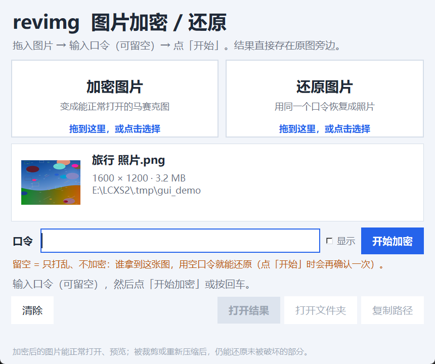

# revimg — 抗破坏的可逆打乱图片容器

把一张图片"加密"成**另一张还能正常打开、正常显示的图片**：旁人看到的只是一片打乱的
马赛克，用密钥可以还原。重点是**抗破坏** —— 重新压缩、裁剪、涂鸦、加水印之后不会整体
报废，只损失被破坏那一块的像素，其余照常还原。

> **Positioning: a file-grade encrypted container.** It is reliable across save / transfer /
> re-encode / crop / scribble. It does **not** survive rescaling: once a platform shrinks the
> image, the payload is gone (see [社交平台](#社交平台会缩放的一律不行)). That boundary is
> measured, not estimated.

> **Windows 用户**：发布版提供两个免安装程序 —— 命令行/菜单版 `revimg.exe` 和拖放图形版
> `revimg-gui.exe`。见 [Windows 可执行文件](#windows-可执行文件exe) 与
> [图形版：拖放界面](#图形版拖放界面)。

---

## 目录

- [能力一览](#能力一览)
- [安装与运行](#安装与运行)
- [Windows 可执行文件](#windows-可执行文件exe)
- [图形版：拖放界面](#图形版拖放界面)
- [快速开始](#快速开始)
- [命令行参考](#命令行参考)
- [输出模式的含义](#输出模式的含义)
- [一条一秒判断法](#一条一秒判断法)
- [实测数据](#实测数据)
- [工作原理](#工作原理)
- [容量与参数](#容量与参数)
- [验收门与 CI](#验收门与-ci)
- [已知边界](#已知边界)
- [复现测量](#复现测量)
- [项目结构](#项目结构)
- [为什么不用现成库](#为什么不用现成库)
- [许可](#许可)

## 能力一览

| 场景 | 结果 |
|---|---|
| 无破坏往返 | 37.7~38.0 dB（SSIM ≈0.88，近无损）；`--lossless` 逐位精确 |
| 存成 JPEG q95 / q85 / q75 | 29.6 / 29.5 / 29.3 dB ✅ |
| JPEG q25 | 28.9 dB ✅ |
| 裁剪 50% | 29.6 dB ✅ |
| 涂鸦 ≈40% 面积 | 26.9 dB ✅ |
| 放大 2× | 35.7 dB ✅ |
| 缩小 0.5× | 20.5 dB（半分辨率拼图）⚠️ |
| 铺满文字水印 / 色块遮挡 | 20.1 / 16.2 dB ⚠️ 能认但难看 |
| **任何会缩放的平台链路（1080/1200/方形裁剪）** | **完全失败** ❌ |

以上数字均为 2000×2000 实测，完整表见[实测数据](#实测数据)。

## 安装与运行

最省事的方式是下载发布页的 **Windows exe**，双击就能用，不需要 Python：

```
revimg.exe            # 命令行/菜单版：双击打开菜单
revimg-gui.exe        # 图形版：拖放 → 输口令 → 点开始
revimg.exe 照片.jpg    # 把图片拖到图标上：先问加密还是还原
```

从源码运行时，只依赖 `numpy` 和 `Pillow`，**不需要安装**，在仓库根目录直接跑：

```bash
pip install numpy pillow
python -m revimg --help
python -m revimg            # 不带参数 = 打开交互菜单
```

想装成命令（需要 setuptools）：

```bash
pip install -e .
revimg --help
```

图形版从源码运行（需要 tkinter 与 tkinterdnd2；Linux 上 tkinter 通常是系统包）：

```bash
pip install -e ".[gui]"
revimg-gui
```

要求 Python ≥ 3.10。

## Windows 可执行文件（exe）

发布版是一个免安装的单文件程序，启动后是中文交互菜单；命令行参数和源码版完全一致。
所有处理都在本机完成，图片和口令不会离开这台电脑。

```
 1. 加密图片    把照片变成能正常打开的“马赛克图”
 2. 还原图片    用口令把马赛克图还原成照片
 3. 查看容量    看看一张图能装多少、能扛多少
 4. 自检        确认程序在这台电脑上工作正常
 0. 退出
```

命令行用法：

```powershell
revimg.exe info 照片.jpg
revimg.exe encode 照片.jpg                 # 口令、强度、输出路径都会问
revimg.exe encode 照片.jpg -p "口令" -q     # 安静模式：只打印输出路径
revimg.exe decode 照片_locked.png           # 默认输出 照片_restored.png
```

口令默认是隐藏输入的，不会出现在命令历史里；自动化场景可以用 `-p`、`--password-file`
或 `REVIMG_PASSWORD` 环境变量。`revimg.exe --version` 查看版本。

**自己构建**（需要 Python 3.12 和网络装构建依赖）：

```powershell
powershell -ExecutionPolicy Bypass -File packaging\build_exe.ps1
```

脚本会创建隔离的 `.venv-build`、安装固定版本的依赖、跑测试、生成图标、打包并自检：

```
dist\revimg.exe                     # 单文件版（默认）
dist\revimg-1.0.0-win64.zip         # 可直接分发的压缩包（exe + LICENSE + README）
```

单文件版每次启动会把运行库解压到 `%TEMP%`（约 1 秒）。如果企业策略禁止在临时目录执行
程序，或杀毒软件对单文件包敏感，可以改用文件夹版（不写临时目录，启动也更快）：

```powershell
powershell -ExecutionPolicy Bypass -File packaging\build_exe.ps1 -OneDir
# -> dist\revimg\revimg.exe
```

PyInstaller 打包的程序偶尔会被杀毒软件误报；正式分发建议给 exe 做代码签名。
打 tag（`v*`）时 `.github/workflows/release.yml` 会自动在 Windows 上构建并上传压缩包。

## 图形版：拖放界面

不想敲命令就用这个：双击 `revimg-gui.exe`，把图片拖进「加密图片」或「还原图片」框，
输入口令（可以留空），再点「开始加密」/「开始还原」（或按回车）；结果直接写在原图旁边。
拖放本身只选中图片、不会开始处理，所以不会用空口令误加密。



```
拖图到「加密图片」 → 输入口令（可留空）→ 点「开始加密」→ 原图旁出现 照片_locked.png
拖图到「还原图片」 → 输入同一个口令     → 点「开始还原」→ 原图旁出现 照片_restored.png
```

- **输出位置**：始终和原图同一个文件夹，不用选路径。
- **不覆盖**：同名文件已存在时自动加 `-2`、`-3`，不会弄丢旧结果。
- **口令留空**：只打乱、不加密 —— 谁拿到图都能用空口令还原。留空仍然可以，只是点
  「开始」时会再确认一次，避免误操作。内部使用固定口令 `revimg-open-v1`；
  命令行还原就写 `-p revimg-open-v1`。
- **错误处理**：口令不对、图片太小、拖进来的不是图片、图片被缩放过，都会弹出中文说明
  和下一步建议；失败时不会留下半成品文件，改好口令可以直接重试，不用重新拖图。
- **先确认再动手**：拖放或点击框只会选出图片；点「开始」或按回车才真正处理；一次处理一张。

自己构建（需要 Python 3.12、网络，以及 Windows 自带的 tkinter）：

```powershell
powershell -ExecutionPolicy Bypass -File packaging\build_exe.ps1 -Gui
# -> dist\revimg-gui.exe  +  dist\revimg-gui-1.0.0-win64.zip
```

加上 `-OneDir` 可生成文件夹版（不写临时目录，启动更快）：

```powershell
powershell -ExecutionPolicy Bypass -File packaging\build_exe.ps1 -Gui -OneDir
# -> dist\revimg-gui\revimg-gui.exe
```

图形版用到的 `tkinterdnd2` 已写进 `packaging/requirements-build.txt`，打包脚本会自动安装。

## 快速开始

```bash
# 0. 不带参数运行 = 交互菜单；下面的命令都有对应的菜单项

# 1. 看看这张图能装多少数据、能扛多少损坏
revimg info photo.jpg

# 2. 加密：输出是一张普通图片，能打开、能预览、能传，内容是打乱的马赛克
revimg encode photo.jpg
#    默认输出 photo_locked.png；口令、强度、输出路径都会询问

# 3. 还原
revimg decode photo_locked.png
#    默认输出 photo_restored.png；口令会安全地询问
```

等价的纯命令行写法（适合脚本）：

```bash
revimg encode photo.jpg locked.png -p "我的口令" --alpha 3.2
revimg decode locked.png restored.png -p "我的口令"
```

Python 里用：

```python
from revimg import encrypt_image, decrypt_image

img, report = encrypt_image("photo.jpg", "口令")
img.save("locked.png")
print(report.as_text())

restored, report = decrypt_image("locked.png", "口令")
restored.save("restored.png")
print(report.as_text())
```

`locked.png` 比原图最多大 127 像素（画布补齐到 128 的倍数，解码时按头部记录自动裁回）。

## 命令行参考

| 命令 | 作用 |
|---|---|
| `revimg` | 打开交互菜单（双击 exe 就是这个） |
| `revimg 照片.jpg` | 问你要加密还是还原，再问口令 |
| `revimg encode 图片 [输出]` | 加密；省略的参数会询问 |
| `revimg decode 图片 [输出]` | 还原；省略的参数会询问 |
| `revimg info 图片 [--json]` | 查看页槽、容量和各强度下的可用载荷 |
| `revimg selftest` | 内置往返自检（错误口令必须被拒绝） |
| `revimg bench 图片` | 开发者：跑完整攻击矩阵与验收门 |

公共选项：`-p/--password 口令`、`--password-file 文件`、`-q/--quiet`、`-y/--yes`、
`--no-color`。超参数：

```bash
--alpha 3.2        # 画质 ↔ 抗破坏的同一个旋钮（见"容量与参数"）
--lossless         # 只打乱、不嵌数据：往返逐位一致，但没有抗破坏能力
--mode fine|coarse # 解码时强制走某一路
--also             # 解码时额外存出 _fine.png / _coarse.png
```

## 输出模式的含义

`decode` 会打印走了哪条路径：

```
 还原
  输入         E:\photos\photo_locked.png  2048×2048

√ 还原完成  0.8 秒
  输出         E:\photos\photo_restored.png
  还原方式     完整还原（画质最好）
  存活页       256/256（100%）
  缩略图       208×208
  画布         2048×2048 · 裁切偏移 (0, 0)
  · 拼图层完整重建，这是最好的结果。
```

| 还原方式 | 含义 | 画质 |
|---|---|---|
| `fine` | 拼图层完整重建 | 最好 |
| `fine+coarse` | 存活块 + 缩略图补洞（被裁/被涂的地方） | 局部糊 |
| `coarse` | 只剩冗余缩略图 | 整体糊但干净 |
| `mosaic` | 没读到载荷，直接按栅格拼图（无损模式，或图片被缩放） | 完整或半分辨率，偏软 |

> 完全解不出来时（口令错、或图被毁得太狠），`decode` 会穷尽所有候选几何，约 15 秒后
> 才报「还原失败」。这是正常的，不是在卡死。

## 一条一秒判断法

> **看收到的那张图，长边像素数有没有变。**
> 没变 → 安全。变小了 → 落到"半分辨率拼图或直接失败"的区间。

因为"保存 / 转发"里的坑，本质上几乎都是**缩放**，而不是压缩。想确认就按三步走：
`encode` 一张真实照片 → 走一遍你实际用的那个渠道发给自己 → 从对方设备存下来 →
`decode` 它，看 `mode` 是不是 `fine`。

## 实测数据

### 破坏基线（2000×2000，`--alpha 3.2`，`demo/make_photo.py` 生成的测试图）

| 攻击 | PSNR | SSIM | 判定 |
|---|---|---|---|
| 无（往返） | 37.7~38.0 | 0.88 | 近无损 |
| 存成 JPEG q95 / q85 / q75 | 29.6 / 29.5 / 29.3 | 0.85 / 0.83 / 0.81 | ✅ |
| JPEG q50 / q25 | 29.1 / 28.9 | 0.80 / 0.85 | ✅ |
| 裁剪 50%（中心 / 角落） | 29.6 / 29.6 | 0.88 | ✅ |
| 涂鸦 10 笔 ≈40% 面积 | 26.9 | 0.89 | ✅ |
| 放大 2× | 35.7 | 0.87 | ✅ |
| 缩小 0.5× | 20.5 | 0.75 | ✅（半分辨率拼图） |
| 铺满文字水印 | 20.1 | 0.82 | ⚠️ 有白色碎点 |
| 色块遮挡 | 16.2 | 0.85 | ⚠️ 很糊 |
| JPEG q12 | 20.3 | 0.62 | ⚠️ 退化到拼图 |
| 裁剪 25% / 10% | — | — | ❌ 存活页数不足 |
| 缩小 0.35× | — | — | ❌ 栅格估不准 |
| 涂鸦 22 笔 ≈70% 面积 | — | — | ❌ 存活页数不足 |
| 冗余缩略图（只剩它时的还原） | 26.9 | 0.89 | 208 px |

2048×2048 基本一致（`demo/bench_2048.json`）；1024×1024 明显更弱（容量只有 1/4，
中心裁 50% 会失败）。

### 社交平台：会缩放的一律不行

按平台典型参数模拟（**这是复现链路，不是在各家 App 里实测的**）：

| 链路 | 结果 |
|---|---|
| 网盘 / 邮件附件 / 云盘链接（不转码） | 近无损 ✅ |
| 原图直传 JPEG q90 | 29.1 dB ✅ |
| 微信/QQ 普通发送（q75 压缩、不缩放） | 28.8 dB ✅ |
| 微博 / IG feed：长边压到 1080 + q80 | **完全失败** ❌ |
| 推特：压到 1200 + q85 | **完全失败** ❌ |
| IG 方形裁剪 + 1080 + q80 | **完全失败** ❌ |
| 转 WebP q80 | 19.1 dB（半分辨率拼图）⚠️ |
| 缩放 1080 + 涂鸦 + 压缩 | **完全失败** ❌ |

**根因**：载荷写在一个 8 像素的网格上，缩放会把这个网格重采样掉 —— 载荷整份失效。
而缩略图、裁剪偏移、擦除图**都住在载荷里**，于是一起失效，所以失败是**二值的**，不是渐变的。

用精确已知的缩放比强行对齐时，0.5× / 0.54× / 0.65× / 0.75× 分别能还原到
28.1 / 28.3 / 29.4 / 31.8 dB —— 说明**信息并没有丢，丢的是几何估计**。所以未来若要做
缩放支持，正确方向不是加数据，而是给解码器一个能定位网格的参考信号（例如在 32 px 粗网格
上再嵌一份小缩略图）。本版没做。

## 工作原理

四层，从"最保真"到"最抗打"：

**1. 可见层 —— 密钥分块打乱**
原图切成 32×32 方块，按密钥全排列，每块再做随机旋转/翻转（D4 群 8 种）。输出还是同一张
图、同样的尺寸，只是变成拼图。**只搬整块、不混像素**，所以被裁掉/涂掉的块消失，
其余块一个像素都不变 —— 这是"只损失被破坏那块"的物理基础。

**2. 强韧层 —— 8×8 DCT 量化嵌入（QIM）**
关键技巧：量化步长取成 **JPEG 量化表的 2 倍**（对齐 q≈20）。这样每个格点都正好落在
JPEG 的量化格点上，JPEG 的"量化 → 反量化"对它完全不动。实测 q25 下误码 0.1%，
而不是断崖式崩溃。

**3. 抗擦除层 —— 每页自带同步字 + CRC + RS**
每页 512 bit：前 16 bit 是密钥派生的同步字（不经过纠错就能读，所以 256 种页相位可以用
极低成本扫描），后面是 RS(62,37) 码字，能纠 12 字节错，里面带
`K / 符号序号 / 页的绝对坐标 / 数据 / CRC16`。一页要么校验通过、要么记为擦除，不污染结果。

**4. 喷泉码 —— 任意 K 个存活符号就能解**
载荷切成 K 块，用 GF(256) 随机线性组合生成冗余符号散布全图。**收到任意 K 个就能解**，
不需要知道坏了多少页。

解码流程：

```
FFT 找栅格 → 折叠法把周期精修到 0.05 像素、相位一起定出
→ 16×16 页相位搜索（用同步字，16 bit 判据）→ 收割页
→ 喷泉解码 → AEAD 解密 → 反打乱 → 与缩略图融合
```

页里带着**自己的绝对页坐标**，所以裁掉一半也知道剩下的页原来在哪，裁剪偏移自动算出来。

**恢复策略**：先试拼图层，与缩略图对得上就用它（细节最好）；对不上或坏了一半以上就用
缩略图（模糊但干净）；裁剪掉/涂掉的区域用缩略图补。全都失败时再试"纯拼图"——
不靠任何载荷，直接按栅格把马赛克拼回去（只能救缩放，且是半分辨率）。

## 容量与参数

```
符号总容量 ≈ (宽 × 高 / 16384) × 29 字节      # 画布补齐到 128 的倍数
可用载荷   ≈ 符号总容量 / alpha               # alpha 默认 3.2
可存活损失 ≈ 1 - 1/alpha                       # 默认约 69% 的页被毁仍可还原
```

2000×2000 → 256 页 × 29 B = **7424 B 符号容量**，默认可用载荷约 2.3 KB（一张 208 px 缩略图）。

`--alpha` 是画质与抗破坏的**同一个旋钮**：

| alpha | 2000×2000 可用载荷 | 仍能扛 |
|---|---|---|
| 2.0 | 3712 B | 50% 页被毁 |
| **3.2（默认）** | 2320 B | 69% |
| 4.0 | 1856 B | 75% |

**兜底画质有硬上限**：把冗余降到 1（零冗余）也只有约 27.8 dB。原因是强韧信道总共只有
七千多字节，而"每像素对应多少字节"决定了缩略图的清晰度 —— 这是换算，不是调参。
所以"裁剪 50% 必须活"和"兜底 ≥28 dB"在 2000×2000 上互斥。

另外，**PSNR 与内容强相关**：同一份缩略图，拍天空能到 29 dB、拍树叶只有 23 dB，视觉质量
其实一样。判"还能不能看"请看 SSIM（≥0.85）和缩略图边长。

## 验收门与 CI

`bench --acceptance` 与 `tests/test_acceptance.py` 用同一套阈值
（`revimg/bench.py::ACCEPTANCE`）：

| 项目 | 门限 |
|---|---|
| JPEG q25 / 存 JPEG q85 | ≥26 dB, SSIM ≥0.78 |
| 裁剪 50%（中心 / 角落） | ≥25 dB, SSIM ≥0.80 |
| 涂鸦 40% | ≥23 dB, SSIM ≥0.80 |
| 缩小 0.5× | ≥17.5 dB, SSIM ≥0.68 |
| 放大 2× | ≥30 dB, SSIM ≥0.80 |
| 冗余缩略图 | 边长 ≥208 px |

```bash
revimg selftest                              # 内置往返自检（exe 里也有）
python -m unittest discover -s tests -v      # 27 个测试，含 10 个验收测试
```

CI（`.github/workflows/ci.yml`）在 Python 3.10 / 3.12 上跑测试，再跑一次验收门；
任何一项退化都会让构建失败。打 `v*` tag 时 `.github/workflows/release.yml` 会在
Windows 上构建命令行版与图形版两个 exe，并发布压缩包。

## 已知边界

* **缩放即失效**（见[社交平台](#社交平台会缩放的一律不行)）。除 0.5× 会退化成半分辨率
  拼图外，其余缩放直接读不出来。
* **容量小**：2000×2000 约 7.4 KB 符号容量、约 2.3 KB 可用载荷。小图更弱，建议 ≥2000×2000。
* **拼图层不是密码学安全的**：分块打乱只保证"看不出内容"，不保证抗已知明文攻击
  （拼图类置换的固有问题）。载荷（缩略图）本身是正经 AEAD 加密的。
* **还原的是像素，不是原文件字节**：EXIF / 元数据不保留。
* **输出尺寸会变**：补齐到 128 的倍数（最多 +127 像素），解码时按头部裁回；
  `--lossless` 只补到 32，且需要自己裁。
* **水印与色块遮挡**恢复得不好看（20.1 / 16.2 dB，图上有错位的碎块）—— 已知，未修。

## 复现测量

```bash
# 并排对比图（原图 / 密文图 / 七种破坏后的还原）
python demo/make_demo.py            # -> demo/comparison.png

# 完整攻击矩阵，结果写入 JSON
python -c "import sys; sys.path.insert(0,'demo'); from make_photo import make_photo; make_photo(2000,2000,seed=33).save('src.png')"
python -m revimg bench src.png -p acceptance-baseline --json demo/bench_2000.json
```

仓库里的 `demo/bench_1024.json`、`demo/bench_2000.json`、`demo/bench_2048.json`
就是按上面命令生成的结果。

## 项目结构

```
revimg/
  gf256.py    GF(256) + Reed-Solomon（BM 纠错，不用多项式除法）
  fountain.py 系统化随机线性喷泉码（GF(256) 高斯消元）
  crypto.py   PBKDF2 + SHAKE-256 流密码 + HMAC-SHA256
  qim.py      8×8 DCT 量化索引调制，格点对齐 JPEG 量化表
  geom.py     栅格检测（FFT 选峰 → 折叠法精修周期与相位）+ 重采样
  spine.py    页框架：同步字 + CRC + RS
  tiles.py    分块打乱 / 反打乱 / 接缝统计（全向量化）
  codec.py    封装、容量规划、解码与融合
  attacks.py  攻击复现（JPEG / 裁剪 / 涂鸦 / 色块 / 水印 / 缩放）
  metrics.py  PSNR / SSIM
  bench.py    攻击矩阵 + 验收判定
  cli.py      友好命令行：菜单、交互询问、进度、中文报错
  gui.py      图形版：拖放暂存、口令确认、进度与中文错误弹窗
  console.py  终端工具：颜色、提示、进度动画、Windows 控制台处理
packaging/    打包：两个 .spec、build_exe.ps1、图标、版本信息
assets/       revimg.ico / revimg.png / gui.png
tests/        27 个测试（编码零件 + 端到端攻击 + 验收门）
demo/         comparison.png、make_demo.py、make_photo.py、bench_*.json
```

## 为什么不用现成库

| 项目 | 能做什么 | 为什么不够 |
|---|---|---|
| [blind_watermark](https://github.com/guofei9987/blind_watermark) | DWT-DCT-SVD 盲水印，抗裁剪 | ~2 KB 上限，**无纠错**，错一 bit 全废 |
| [invisible-watermark](https://github.com/ShieldMnt/invisible-watermark) | 64 bit 强韧水印 | 官方承认 resize 50% / crop 失败 |
| [imagewmark](https://github.com/tim-janik/imagewmark) | 真抗裁剪 + 缩放 + JPEG | 载荷写死 128 bit；GPL-3 |
| [PaperBack](https://github.com/Rupan/paperbak) | 文件 → 点阵图 → 扫描还原 | 输出是噪点码，不是照片 |
| [reedsolo](https://pypi.org/project/reedsolo/) | RS 纠错 | 只是个零件，没有"页框架 + 擦除图" |
| Imuge / ReImage | 神经网络自嵌入恢复 | 近似恢复、无密钥、研究代码 |

缺的那块拼图是：**每符号自带校验 → 知道哪些数据还活着 → 交给喷泉码**。所有水印库都只给
一个 bit 数组，不知道哪 bit 可信，所以只能全有或全无。

## 许可

**[GPL-3.0-or-later](LICENSE)**（GNU 通用公共许可证第 3 版，或任何更新版本）

简单说，你可以：

- **自由使用**：个人、公司内部、商业用途都可以，不收费；
- **自由修改**：改源码、改参数、去掉你不喜欢的功能；
- **自由分发**：原样或改过之后都可以再发布。

条件是：**如果你分发（或让别人下载）修改后的版本，必须以同样的 GPL-3.0 开放源码**，
并保留版权声明、不额外加限制。另有两点：

- **用这个工具处理你自己的图片不受任何影响** —— 照片、密文图、还原出来的图的版权
  完全属于你，GPL 只约束程序本身的复制与分发。
- **没有担保**：软件按"现状"提供，作者不对数据丢失或恢复失败负责。重要数据请自行
  保留原始副本 —— 这个项目本质上是"多一层保险"，不是备份方案。

源码文件顶部都带 `SPDX-License-Identifier: GPL-3.0-or-later`，机器可读。
本项目的全部依赖（`numpy` BSD-3、`Pillow` MIT-CMU）都是宽松许可，与 GPL 兼容。

分发 `revimg.exe` 时请一并附上 `LICENSE` 并指明源码位置（构建脚本会把 `LICENSE` 放进
`dist` 和发布压缩包）。
